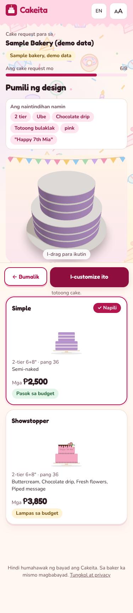
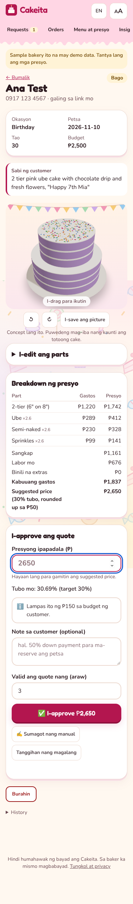
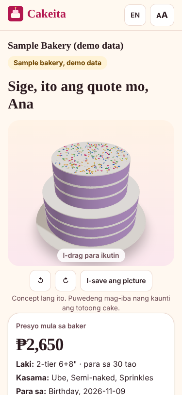

# Cakeita

**Kita sa bawat hiwa.** Budget-first custom cake quotes with a live 3D cake, for Filipino home bakers.

A customer says what they need ("2 tier pink, 30 pax, budget 2.5k, Dec 12"). Cakeita shows three designs they can turn around in 3D (Simple, Classic, Showstopper), each priced from the **baker's own costs**. The baker checks the cost breakdown, approves, and sends the quote back through Messenger. **AI only reads the request. Plain code does all the math. The baker approves every quote. Cakeita never handles payments.**

Build-Off 2026 (Business Edition) · recommended category: **Customer Experience** (runner-up: Sales & Marketing).

| Customer picks a design | Baker approves with a cost breakdown | Customer gets the quote |
| --- | --- | --- |
|  |  |  |

## Why it matters

Home bakers quote custom cakes by hand in Messenger, one message at a time. Customers send inspo photos that cost far more than their budget, and many bakers price from memory, so rising ingredient prices quietly eat their profit. *(This is our hypothesis from talking to bakers; see [docs/VALIDATION.md](docs/VALIDATION.md) for how we are confirming it with real numbers.)*

## What makes it different

- **The picture and the price come from the same parts list.** The 3D cake is built from the exact parts that are priced, so the design can't promise something the price doesn't include. No paid image generation, no AI "hallucinated" cakes, works offline.
- **Budget first.** The customer's budget shapes the designs, instead of the baker saying "₱4,500 po" to a ₱2,000 budget and losing the sale.
- **Lugi alerts.** When butter goes up, Cakeita shows which menu prices no longer earn the target margin and suggests a new price.
- **Zero server, zero cost.** Requests and quotes travel as links inside Messenger. Data stays on each phone. Hosting is a free static site.
- **Taglish and elders.** Taglish by default, English toggle, and a big-text mode for Lolo and Lola.
- **One page to order.** Type the cake like a Messenger message; designs, 3D cake and price update as you type. No Next-Next-Next.
- **Bakers near me.** A map compares nearby bakers for *the same cake*, each priced from that baker's own costs, and flags who can't make it, can't make the date, or doesn't deliver. One tap sends the request to the chosen baker.

## Try it

```bash
npm ci
npm run dev          # http://localhost:5173
```

- Customer: open `/#/b/sample` (the sample bakery, clearly labeled as demo data).
- Map: open `/#/near`, or tap **Compare bakers near me** on the order page. The 12 shops on the map are fictional samples.
- Baker: open `/#/baker` and tap **Use the demo bakery**, or set up your own in 3 steps.
- **Developer panel:** add `?dev=1` to the URL (e.g. `http://localhost:5173/?dev=1#/b/sample`) or tap the Cakeita logo 5 times. It can fill a customer scenario and jump to any step, load a demo board, approve/confirm everything, reset data, and simulate "no WebGL" or "AI off".

## Setup you need

| Thing | Needed? | Why | Cost |
| --- | --- | --- | --- |
| GitHub repo | Done | Source code and CI | Free |
| Vercel account (sign in with GitHub) | For a public link | Free static hosting + the optional AI route | Free (Hobby) |
| Google AI Studio key (`GEMINI_API_KEY`) | Optional | Smarter reading of messages and inspo photos | Free tier |
| Firebase project (Auth + Firestore, Spark plan) | For accounts | Sign-in (Facebook, Google, email link), cloud inbox, live quotes, real bakers on the map. Config is in `src/cloud/config.ts` (public by design). Paste `firestore.rules` into Firestore → Rules. Without it, everything still works through Messenger links | Free (Spark) |
| Map pictures | Nothing to set up | CARTO Voyager tiles (OpenStreetMap data), falls back to OpenStreetMap tiles. Needs internet; prices and the list work without it | Free, with attribution |

Without a Gemini key, everything still works with the built-in offline Taglish reader.

### Accounts (Firebase)

1. Authentication → Sign-in method: enable **Google**, **Email/Password** with **Email link**, and **Facebook** (needs a Meta app's App ID and secret; paste Firebase's OAuth redirect URI into the Meta app, set its privacy policy URL, switch it to Live).
2. Authentication → Settings → Authorized domains: add your Vercel domain.
3. Firestore → Rules: paste `firestore.rules` and Publish. Test them locally with `npm run test:rules` (needs `firebase-tools`).
4. Customers never need an account. A device can switch the cloud off in the **Demo** tab (offline demo mode); test robots run offline automatically.

### Environment variables

Copy `.env.example` to `.env.local` for local work. On Vercel, set them in Project → Settings → Environment Variables.

| Name | Where | Notes |
| --- | --- | --- |
| `GEMINI_API_KEY` | Server only | From https://aistudio.google.com/apikey. Never prefix with `VITE_`. |
| `GEMINI_MODEL` | Server only | Optional, comma-separated list tried in order. Defaults to `gemini-3.6-flash, gemini-3.5-flash-lite, gemini-2.5-flash`; a retired, gated or rate-limited model falls through to the next. |

## Deploy (free)

**Vercel (recommended, includes the AI route):**
1. Go to https://vercel.com/new, import `EliteKnight17-lordran/cakeita`.
2. Framework: Vite (auto-detected). Build `npm run build`, output `dist`.
3. Optional: add `GEMINI_API_KEY` (and `GEMINI_MODEL`). Redeploy.
4. Open `https://<your-app>.vercel.app/#/b/sample`. The developer panel shows "AI route: on" when the key works.

**Static only (Netlify, GitHub Pages, Cloudflare Pages):** upload `dist/`. Everything works except smart AI reading, which falls back to the offline reader automatically.

> Note: the AI route (`api/parse.ts`) is unit-tested but was not yet run on a live Vercel deployment from this repo. If it fails, the app keeps working with the offline reader; check the function logs in Vercel.

## Scripts

| Command | What it does |
| --- | --- |
| `npm run dev` | Dev server |
| `npm run check` | Typecheck + lint + unit tests + build (what CI runs) |
| `npm test` | 181 unit tests (Vitest) |
| `npm run build && npm run e2e` | End-to-end walkthrough on 4 simulated phones + accessibility scans (Playwright + axe) |

## How it works

```
Customer phone                         Baker phone
──────────────                         ───────────
budget, people, idea (Taglish)
  → offline reader (+ optional AI) picks part IDs from the baker's public menu
  → design builder makes Simple / Classic / Showstopper   (code)
  → price estimate from per-part contributions            (code)
  → 3D cake drawn from the same parts
  → "Send to baker" = a link in Messenger ───────────────→ opens in Requests
                                                         baker edits parts, sees cost,
                                                         labor, margin; approves ₱X
  quote page ←──────────────────────── quote link in Messenger
  "Ito ang gusto ko" → confirm link ───────────────────→ order board, shopping list
```

Details: [docs/ARCHITECTURE.md](docs/ARCHITECTURE.md). Requirements and user stories: [docs/REQUIREMENTS.md](docs/REQUIREMENTS.md). Testing: [docs/TEST_PLAN.md](docs/TEST_PLAN.md) and [docs/QA_REPORT.md](docs/QA_REPORT.md). Stage demo: [docs/DEMO_SCRIPT.md](docs/DEMO_SCRIPT.md).

## Pricing rule

```
cost  = ingredients (qty × your price) + labor (minutes ÷ 60 × your hourly rate) + bought-in extras
price = cost ÷ (1 − target margin), rounded UP to the nearest ₱50, never below your minimum order
```

Frosting and decorations scale with cake size. The customer's estimate and the baker's suggested price are computed the same way and always match (tested for every cake size in every starter menu).

## Known limits

- **The sample map bakeries are fictional** and labeled. Real bakers who sign in can list themselves (pin rounded to about 100 m); they show first on the map.
- Anyone can send a request to a listed baker without an account. Spam protection (Firebase App Check) is a next step.
- Map pictures need internet. Free map tiles have fair-use limits, fine for a pilot, not for a big launch.

- The 3D cake is a concept, not a photo. Every view says so.
- Sample ingredient prices are estimates (Metro Manila, late 2026, unverified) and are labeled "estimate, edit me".
- Without an account, data is per device (browser storage). With an account, the bakery and "My cakes" sync to Firestore; the phone stays the working copy, so it keeps working offline.
- A bakery link carries the menu; after big price changes the baker shares the new link. The baker always re-checks the price at approval.
- Trademarked characters are turned into generic themes; bakers should use licensed toppers.
- Voice price updates use the browser's speech recognition (Chrome on Android works; iPhone Safari support varies).
- Rate limiting on the AI route is per server instance (fine for a demo, not for production).

## Rules we follow

No payments in the app and no payment look-alikes. No real customer data in the repo: all sample names are fictional. Claims about the problem are labeled as hypotheses until validated.
